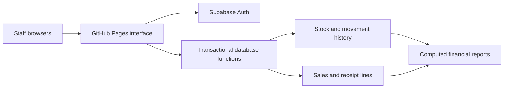

# Campus Supply Co. ERP

A team class project for a fictional campus supplies retailer that also assembles kits. This is **milestone 1, a working foundation**, not the completed 12-capability assignment.

The starter connects staff login, inventory at three locations, reason-coded adjustments, transfers, barcode checkout, receipts, and financial reports to a shared Supabase PostgreSQL database. Future work is tracked in [PROJECT_PLAN.md](PROJECT_PLAN.md) and inside the app's Project guide.

## Set it up without installing anything

One project owner does steps 1–4; each teammate does step 5.

### 1. Add this pull request to the repository

Open the starter pull request, click **Merge pull request**, then **Confirm merge**. The files will appear on the repository's `main` branch.

### 2. Create and seed the database

In your new Supabase project, open **SQL Editor → New query**.

1. In GitHub, open [supabase/001_schema.sql](supabase/001_schema.sql), click **Raw**, and copy its full contents. Paste into SQL Editor and click **Run**. Run this file once, in a fresh project. It creates tables, permissions, and transaction functions; it does not drop existing data.
2. Open a new SQL query. Copy and run [supabase/002_seed.sql](supabase/002_seed.sql). This adds 25 barcoded products, 5 kit BOMs, 3 locations, 6 suppliers, 10 fictional customers, and at least 6 months of sales history. The seed file can be run again safely without duplicating its data.
3. Check Supabase **Table Editor → products**. You should see 25 rows.

Keep the SQL files in the repository. Later changes will be added as new migrations rather than rerunning the initial schema.

### 3. Create your six staff accounts

In Supabase **Authentication → Users → Add user → Create new user**, create an account for each teammate. Use their own email and a private password; enable **Auto Confirm User** if shown so class setup does not depend on email delivery. Share each password privately with its owner.

Copy the user's UID. In SQL Editor, run the following with the actual UID and teammate name:

```sql
insert into public.team_members(user_id, display_name)
values ('PASTE-THE-USER-UID-HERE'::uuid, 'Colby')
on conflict(user_id) do update set display_name=excluded.display_name;
```

Repeat for all six teammates. [supabase/003_enroll_team.sql](supabase/003_enroll_team.sql) also explains this step. Merely creating an Auth user does **not** grant staff access; enrollment is required. Customer accounts must not be enrolled here.

### 4. Turn on GitHub Pages

In this GitHub repository, open **Settings → Pages**:

1. Set Source to **Deploy from a branch**.
2. Select branch **main** and folder **/docs**.
3. Click **Save** and wait for GitHub to show the deployed link. The first deployment can take a few minutes.

The `docs/` folder already contains the compiled app, so no workflow or local Node installation is needed for first-time hosting. GitHub hosts the interface; Supabase stores all business data. Enabling Pages is a manual project-owner step; creating the starter PR does not activate it.

### 5. Connect each browser and sign in

Open the GitHub Pages link. The first screen asks for:

- **Supabase Project URL**, found in the project's Connect dialog / Project Settings → Data API.
- **Publishable key** (`sb_publishable_…`), found in Project Settings → API Keys. A legacy **anon** key is also supported.

These are public client settings. Save them on the connection screen, then sign in with your own enrolled staff account. Every teammate must use the same project URL and public key. Never enter a secret key (`sb_secret_…`), a `service_role` key, or the database password. The app rejects privileged keys on its connection screen. Passwords belong only in the sign-in form.

Connection settings are stored in that browser, while business records are shared in Supabase. A different browser needs its own connection setup. Optional environment-based configuration is shown in [.env.example](.env.example); it is unnecessary for the steps above.

## Try the connected workflow

1. In Inventory, select **Storefront** and note a product's stock.
2. Open Checkout. Scan the printed barcode with a USB scanner, or type its barcode (for example `CS00001`) and press Enter. Add another item, set a discount, and complete the sale.
3. Inspect the stored receipt and print it if needed.
4. Return to Inventory: quantities should have fallen by the sold amounts.
5. In Reports, include today's **UTC date**: net sales and costs should include the sale. Tax is excluded from revenue.
6. Open a second enrolled login on another computer, repeat a sale on the first computer, and check that inventory updates on the second. Realtime is enabled where supported; the fallback checks every 10 seconds while the page is idle. The Refresh button checks immediately.

Use **Inventory → Print barcode labels** to print Code 128 labels. A USB scanner must send Enter after each scan. Scan-to-adjust works by scanning into Inventory search and pressing Enter. Test printed labels with the scanner you will bring to class; typing a barcode is useful during development but does not prove physical scanning works.

## What is implemented

- Staff authentication and explicit enrollment; row-level security on all business tables.
- On-hand inventory by item and location; transfers with weighted average costing; cycle-count and damage adjustments with explanations.
- Transactional multi-line checkout, repeated-scan aggregation, database-controlled prices, stored tax rate, discounts, revenue, product costs, and receipts. Negative stock is rejected. A checkout retried with the same request ID records only one sale.
- Code 128 labels, keyboard/USB scan-to-add, and scan-to-adjust.
- Daily sales, recent receipts, top products, low-stock flags, location valuation, modeled P&L, and period inventory turnover, all calculated from records.
- Realistic starting records and historical demand with weekday, item-popularity, and seasonal differences.
- In-app tool documentation and an honest assignment checklist.

## What remains before the final demo

Sales orders, returns/exchanges, production operations and quality metrics, supplier editing and scorecards/payments, lead-time reorder rules and EOQ, backorders/availability dates, MRP, customer pickup ordering, a wow feature, and live acceptance checks. The five BOMs and supplier records are starting data, not functioning production operations. Purchasing is added by migration 004 below. Kits in this starter are sold from preassembled finished stock; checkout does not also consume their components.

The starter P&L covers the events implemented so far. It does not record rent, payroll, supplier bills, returns, or a full accounting general ledger. Inventory turnover is COGS for the selected period divided by the average of opening and closing inventory value; it is **not annualized**. The tax rate is fictional for class and editable by the project owner in `settings`.

See [PROJECT_PLAN.md](PROJECT_PLAN.md) for ownership and build order and [VERIFICATION.md](VERIFICATION.md) for checks to run before demonstrating.

## Editing the code later

Install a current Node.js LTS release (22.12+ or 24), then clone this repository:

```sh
npm ci
npm run dev
```

Vite prints the local development URL. In another terminal:

```sh
npm test
```

`npm test` builds the app into `docs/` and runs PostgreSQL tests through PGlite, helper tests, and DOM interaction tests using a fake Supabase transport. It needs no production credentials. Tests never touch the team's live database. Test doubles do not prove the deployed API, browser layout, Realtime, or printed barcode hardware works.

After source changes, run `npm test` (or `npm run build` for a build only) and commit the regenerated `docs/` folder together with the source. Never edit generated files inside `docs/` by hand. Merge the reviewed pull request; GitHub Pages then publishes that folder. Don't put notes in `docs/` because rebuilding replaces it.

## How the pieces fit



Sales snapshot prices and unit costs so later cost changes do not rewrite past profit. Transfers remove value at the source cost and recalculate the destination average. The movement ledger records opening balances, generated historical replenishments, sales, transfers, and adjustments, enabling quantity and value reconciliation. All financial date filtering uses UTC; individual transaction timestamps are displayed in the viewer's local timezone.

AI coding assistance: **OpenAI Codex in ChatGPT**. Frontend: **JavaScript + Vite**. Shared database, identity, and change notifications: **Supabase PostgreSQL, Auth, Realtime**. Barcodes: **JsBarcode**. Testing: **Node test runner, PGlite, Happy DOM**. Code collaboration and interface hosting: **GitHub and GitHub Pages**. Your team remains responsible for verifying results and understanding the ERP concepts.

## Purchasing update: apply to your existing project

After merging the purchasing pull request, run **only** [supabase/004_purchasing.sql](supabase/004_purchasing.sql) in a new Supabase SQL Editor query. Do not rerun 001 or reseed/reset your database. This migration preserves existing users, inventory, and sales. Refresh the website; the Purchasing tab is available. Until the migration is applied, that tab displays setup instructions and the original modules still work.

In Purchasing, create a PO for a supplier, enter quantities and negotiated costs, and save it. Creation marks it **Order Sent** as a class simulation; the app does not email suppliers. Use View / print to print or save the PO. Expected date is sent date (UTC) plus the supplier's quoted lead days, snapshotted together with payment terms. Choose Receive delivery, optionally scan the item barcode, select the PO item and receiving location, and enter the quantity that arrived. Multiple partial receipts are allowed; over-receiving is rejected. Receipt history compares actual dates with expected dates. Receipt costs update weighted inventory valuation and the movement ledger; purchasing inventory does not immediately create a sales expense. Fully received POs become Received and can then be Closed.

Supplier editing, historical PO data, payments/bills, supplier scorecards, reorder rules, and EOQ remain future work. PO receipt retries on the same open form use the same request ID; if a network result is unclear, inspect history before reopening the form or refreshing the browser. Real multi-session receiving and physical barcode tests are still required.
