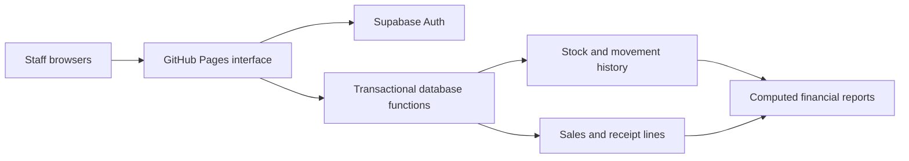

# Campus Supply Co. ERP

A team class project for a fictional campus supplies retailer that also assembles kits. The connected ERP is in active development; remaining capabilities are tracked in the Project guide.

The app connects staff login, inventory at three locations, adjustments, transfers, barcode checkout, sales orders, supplier management, purchasing, MRP, and financial reports to a shared Supabase PostgreSQL database. Future work is tracked in [PROJECT_PLAN.md](PROJECT_PLAN.md) and inside the app's Project guide.

## Set it up without installing anything

One project owner does steps 1–4; each teammate does step 5.

### 1. Add this pull request to the repository

Open the starter pull request, click **Merge pull request**, then **Confirm merge**. The files will appear on the repository's `main` branch.

### 2. Create and seed the database

In your new Supabase project, open **SQL Editor → New query**.

1. In GitHub, open [supabase/001_schema.sql](supabase/001_schema.sql), click **Raw**, and copy its full contents. Paste into SQL Editor and click **Run**. Run this file once, in a fresh project. It creates tables, permissions, and transaction functions; it does not drop existing data.
2. Open a new SQL query. Copy and run [supabase/002_seed.sql](supabase/002_seed.sql). This adds 25 barcoded products, 5 kit BOMs, 3 locations, 6 suppliers, 10 fictional customers, and at least 6 months of sales history. The seed file can be run again safely without duplicating its data.
3. Check Supabase **Table Editor → products**. You should see 25 rows.

Keep the SQL files in the repository. Later changes will be added as new migrations rather than rerunning the initial schema.

### 3. Create your six staff accounts

In Supabase **Authentication → Users → Add user → Create new user**, create an account for each teammate. Use their own email and a private password; enable **Auto Confirm User** if shown so class setup does not depend on email delivery. Share each password privately with its owner.

Copy the user's UID. In SQL Editor, run the following with the actual UID and teammate name:

```sql
insert into public.team_members(user_id, display_name)
values ('PASTE-THE-USER-UID-HERE'::uuid, 'Colby')
on conflict(user_id) do update set display_name=excluded.display_name;
```

Repeat for all six teammates. [supabase/003_enroll_team.sql](supabase/003_enroll_team.sql) also explains this step. Merely creating an Auth user does **not** grant staff access; enrollment is required. Customer accounts must not be enrolled here.

### 4. Turn on GitHub Pages

In this GitHub repository, open **Settings → Pages**:

1. Set Source to **Deploy from a branch**.
2. Select branch **main** and folder **/docs**.
3. Click **Save** and wait for GitHub to show the deployed link. The first deployment can take a few minutes.

The `docs/` folder already contains the compiled app, so no workflow or local Node installation is needed for first-time hosting. GitHub hosts the interface; Supabase stores all business data. Enabling Pages is a manual project-owner step; creating the starter PR does not activate it.

### 5. Connect each browser and sign in

Open the GitHub Pages link. The first screen asks for:

- **Supabase Project URL**, found in the project's Connect dialog / Project Settings → Data API.
- **Publishable key** (`sb_publishable_…`), found in Project Settings → API Keys. A legacy **anon** key is also supported.

These are public client settings. Save them on the connection screen, then sign in with your own enrolled staff account. Every teammate must use the same project URL and public key. Never enter a secret key (`sb_secret_…`), a `service_role` key, or the database password. The app rejects privileged keys on its connection screen. Passwords belong only in the sign-in form.

Connection settings are stored in that browser, while business records are shared in Supabase. A different browser needs its own connection setup. Optional environment-based configuration is shown in [.env.example](.env.example); it is unnecessary for the steps above.

## Try the connected workflow

1. In Inventory, select **Storefront** and note a product's stock.
2. Open Checkout. Scan the printed barcode with a USB scanner, or type its barcode (for example `CS00001`) and press Enter. Add another item, set a discount, and complete the sale.
3. Inspect the stored receipt and print it if needed.
4. Return to Inventory: quantities should have fallen by the sold amounts.
5. In Reports, include today's **UTC date**: net sales and costs should include the sale. Tax is excluded from revenue.
6. Open a second enrolled login on another computer, repeat a sale on the first computer, and check that inventory updates on the second. Realtime is enabled where supported; the fallback checks every 10 seconds while the page is idle. The Refresh button checks immediately.

Use **Inventory → Print barcode labels** to print Code 128 labels. A USB scanner must send Enter after each scan. Scan-to-adjust works by scanning into Inventory search and pressing Enter. Test printed labels with the scanner you will bring to class; typing a barcode is useful during development but does not prove physical scanning works.

## What is implemented

- Staff authentication and explicit enrollment; row-level security on all business tables.
- On-hand inventory by item and location; transfers with weighted average costing; cycle-count and damage adjustments with explanations.
- Transactional multi-line checkout, repeated-scan aggregation, database-controlled prices, stored tax rate, discounts, revenue, product costs, and receipts. Negative stock is rejected. A checkout retried with the same request ID records only one sale.
- Code 128 labels, keyboard/USB scan-to-add, and scan-to-adjust.
- Daily sales, recent receipts, top products, low-stock flags, location valuation, modeled P&L, and period inventory turnover, all calculated from records.
- Realistic starting records and historical demand with weekday, item-popularity, and seasonal differences.
- Supplier editing, PO drafting and dispatch recording, receipt bills/payments, computed supplier scorecards, lead-time reorder rules, EOQ, manual review and four-week MRP (migrations 006/007).
- In-app tool documentation and an honest assignment checklist.

## What remains before the final demo

Returns/exchanges, production operations and quality metrics, production-to-MRP firm-supply integration, customer pickup ordering, complete availability/backorder workflows, a team wow feature, and live acceptance checks remain. Five single-level kit BOMs are supplied; build execution belongs to the production module. Purchasing/MRP functionality is documented in [PURCHASING_MRP_GUIDE.md](PURCHASING_MRP_GUIDE.md).

The starter P&L covers the events implemented so far. Purchasing now records receipt bills and payments separately; bill payment is not another P&L expense. Rent, payroll, returns and a full accounting general ledger remain outside this implementation. Inventory turnover is COGS for the selected period divided by the average of opening and closing inventory value; it is **not annualized**. The tax rate is fictional for class and editable by the project owner in `settings`.

See [PROJECT_PLAN.md](PROJECT_PLAN.md) for ownership and build order and [VERIFICATION.md](VERIFICATION.md) for checks to run before demonstrating.

## Editing the code later

Install a current Node.js LTS release (22.12+ or 24), then clone this repository:

```sh
npm ci
npm run dev
```

Vite prints the local development URL. In another terminal:

```sh
npm test
```

`npm test` builds the app into `docs/` and runs PostgreSQL tests through PGlite, helper tests, and DOM interaction tests using a fake Supabase transport. It needs no production credentials. Tests never touch the team's live database. Test doubles do not prove the deployed API, browser layout, Realtime, or printed barcode hardware works.

After source changes, run `npm test` (or `npm run build` for a build only) and commit the regenerated `docs/` folder together with the source. Never edit generated files inside `docs/` by hand. Merge the reviewed pull request; GitHub Pages then publishes that folder. Don't put notes in `docs/` because rebuilding replaces it.

## How the pieces fit



Sales snapshot prices and unit costs so later cost changes do not rewrite past profit. Transfers remove value at the source cost and recalculate the destination average. The movement ledger records opening balances, generated historical replenishments, sales, transfers, and adjustments, enabling quantity and value reconciliation. All financial date filtering uses UTC; individual transaction timestamps are displayed in the viewer's local timezone.

AI coding assistance: **OpenAI Codex in ChatGPT**. Frontend: **JavaScript + Vite**. Shared database, identity, and change notifications: **Supabase PostgreSQL, Auth, Realtime**. Barcodes: **JsBarcode**. Testing: **Node test runner, PGlite, Happy DOM**. Code collaboration and interface hosting: **GitHub and GitHub Pages**. Your team remains responsible for verifying results and understanding the ERP concepts.

## Purchasing, suppliers and MRP update (006/007)

**Existing project with 001–005 already applied:** after merging this update, run only [006_supplier_planning_mrp.sql](supabase/006_supplier_planning_mrp.sql), then [007_supplier_history.sql](supabase/007_supplier_history.sql), each in a new Supabase SQL Editor query. Do not rerun prior schema/seed files. 006 extends the schema; 007 links existing generated historical replenishments to supplier history without receiving that inventory again. 007 has an import marker to prevent duplicate imports. No live database was changed while preparing the code.

For a completely new project, finish the initial schema, seed and staff enrollment above, then apply 004, 005, 006 and 007 in that order. If a query errors, retain the exact message and stop before running another migration.

Purchasing now has **Purchase orders**, **Suppliers & payments**, and **Reorder & EOQ** sections, plus a separate **MRP** navigation item. Save a PO draft, prepare an email in your own email client or print/share the document, then record dispatch. Record partial receipts into its planned location. Receipt bills have due dates and support partial payment recording. Supplier ratings come from all stored sent PO/receipt/payment history, including labelled generated examples. Reorder and EOQ use six months plus today's sales, editable costs, safety stocks and review intervals. The MRP plan uses confirmed sales orders, kit BOMs, available stock and timely incoming POs by location/date.

Read [PURCHASING_MRP_GUIDE.md](PURCHASING_MRP_GUIDE.md) for exact formulas, new UI steps, email/payment limitations, production integration, historical import invariants and acceptance checks. Its workflow supersedes the original 004 UI, which immediately marked POs sent as a simulation. Existing legacy POs and transactions are preserved. Unassigned legacy incoming supply must be assigned a delivery location before MRP can use it.

## POS and sales orders (capabilities 1 and 4)

POS already supports multi-line checkout, barcode entry, discounts, taxes, receipts, inventory reduction and stored revenue/COGS. This update fixes a half-cent tax preview rounding case ($2 at 7.25% now previews $0.15 tax, matching the database), preserves that flow and adds a **Sales orders** tab for staff. It is implemented in code and automated tests; live verification is still required. Both checkout and fulfillment are class simulations: no card or payment service is connected.

After review/merge, the project coordinator must run **only `supabase/005_sales_orders.sql` once, after `004_purchasing.sql`** in the existing project. Do not reset/reseed or rerun earlier migrations. No shared Supabase changes were performed by this update. If 005 is missing, Sales orders shows setup guidance while POS and existing modules remain usable. Coordinate the `005` filename before merging if another teammate has added a migration.

1. Open **Sales orders → New sales order**. Choose a customer, pickup location and required date (today in UTC or later), then enter quantities and a discount if needed. The customer records from the existing shared database are reused.
2. Place the order and view/print the saved quote. It stores server-controlled prices, names/SKUs, tax rate and discount so later catalog/tax changes do not alter this order. Placement records confirmed demand; **it does not reserve physical stock, collect payment, reduce stock or record revenue**.
3. When handing over the complete order, click **Fulfill order** once. The database checks/locks every item's stock at that location and records one sale/receipt, one set of stock deductions, and current weighted inventory costs. A shortage rejects the entire transaction; receive/transfer stock and retry. Prebuilt kits consume finished stock, matching existing POS, rather than also consuming components.
4. Use **View receipt**, then **Close order**. Closing changes the workflow only. **Cancel order** is allowed only before fulfillment and has no financial effect. Fulfilled orders cannot be cancelled; future returns/exchanges must link to their stored receipt.
5. If an order creation response is lost, the saved request remains in that browser for that user; use **Retry / confirm order**. Repeating fulfillment/closing/cancellation also cannot record another sale. Do not clear browser storage or switch browsers to recreate an uncertain order: inspect the list first. The latest orders are paginated, 100 per page. The normal 10-second idle refresh/manual Refresh checks other users' changes; open dialogs defer refresh.

### Interface for other feature owners

- Staff-only `sales_orders` headers contain `customer_id`, `location_id`, `required_date`, `status`, `created_at`, `created_by`, quote totals, lifecycle timestamps and nullable unique `sale_id`. `sales_order_lines` contains `sales_order_id`, `product_id`, confirmed integer `quantity`, and quote snapshots. Relationships use the existing product/customer/location tables.
- **MRP:** read lines whose header is `Order Placed`, grouped by `location_id` and `required_date`. Quantity is confirmed outstanding demand; there is no separate reservation quantity to subtract. Exclude Fulfilled, Closed and Cancelled. Query the database with appropriate date filters and pagination, not the UI's current 100-row page. Migration 006 now implements BOM/stock/PO netting from that interface. See PURCHASING_MRP_GUIDE.md for the issued-build supply adapter the production owner must connect.
- **Returns/finance:** `sales_orders.sale_id` links fulfillment to the ordinary `sales`, `sale_lines` and `movements` used by POS and existing reports. Revenue excludes tax and subtracts discount; COGS uses costs at fulfillment. Placement/cancellation/closing do not alter P&L. No duplicate order finance ledger exists.
- **Customer portal:** this migration deliberately grants no customer access. A later reviewed migration must map Auth identities to customer records, provide safe availability and customer-owned order policies/functions. Do not enroll customers as staff or expose staff RPCs. Customer login and self-service pickup ordering remain unfinished.
- Writes go through staff RPCs `create_sales_order(p_id,p_customer,p_location,p_required_date,p_items,p_discount)` and `transition_sales_order(p_order,p_status)`; direct browser table writes are denied. Existing POS checkout is unchanged. Do not check out an order a second time at POS: use **Fulfill order**.

Most new UI logic is isolated in `src/sales-orders.js`; `src/app.js` has only module wiring, navigation, refresh and login-state cleanup. Coordinate edits to that shared file. See VERIFICATION for automated evidence and required live checks.
